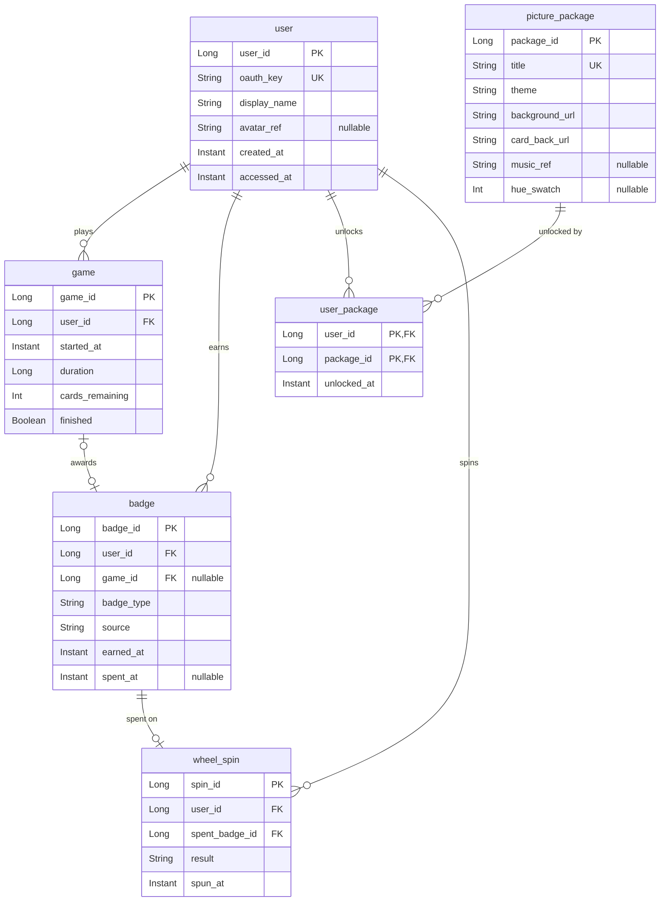

# ERD Review: HandSolitaireERD

Review of `docs/img/HandSolitaireERD.svg` (and `docs/pdf/HandSolitaireERD.pdf`), 2026-11-16.

## Core ideas behind most of the fixes

1. **Every primary key (PK) should be a meaningless ID number.** Use something like
   `game_id: Long`, generated automatically. Real data like `finished: boolean` or `theme_set`
   shouldn't be a key.
2. **A foreign key (FK) is a copy of another table's PK.** It always goes on the "many" side of a
   relationship. `game.user_id → user.user_id` is right. FKs pointing at ordinary columns
   (`badge_name`, `player_level`, `finished`) are not.
3. **Every relationship line connects a PK to an FK.** If you draw a line, one end's table needs an
   FK column pointing at the other. If there's an FK column, there should be a line.
4. **A column holds a single value.** Lists like `Array<String>` become their own table.
5. **Store facts, not things you can calculate.** This is the same rule as in `index.md`.

## Table by table

### `user`

| Issue | Fix |
|---|---|
| `user_id: char` | Use `Long`, auto-generated. `char` is a single character. |
| `UK3 player_level` | UK means no two users can share a value, so only one user could ever be level 3. Remove UK3. `index.md` doesn't describe player levels anyway, so you could drop this column entirely. |
| `read_player_level` | Unclear what this is, possibly a leftover. Remove it or define it. |
| `assets: Array<String>` | A list in one column breaks rule 4. Replace it with a `user_package` join table (below). |
| `FK1 badge_id` | Backwards. As drawn, a user holds a single badge. A user earns **many** badges, so the FK goes in `badge` as `badge.user_id`. |
| `created_at: String`, `accessed_at: String` | Use a date/time type (`Instant`). Room stores it as a number through a type converter. |
| `avatar_ref:` | Missing a type: `String?` (the `?` means nullable, if an avatar is optional). |
| `UK2 oauth_key` | Good. The `index.md` Player section doesn't mention sign-in, though. Add it there or drop it here so the two documents match. |

### `game`

| Issue | Fix |
|---|---|
| `game_id:` | Needs a type: `Long`. |
| `score: Int` | The actual measure is `cards_remaining: Int`. Rename it. |
| `geme_icon` | Typo, and unclear purpose. A game probably doesn't need an icon, so consider removing it. |
| `FK2 finished: boolean` | Not an FK, so remove the FK2 label. It's fine as a plain column. |
| Missing | `started_at: Instant`, `duration: Long` (milliseconds), needed for best time. |
| Missing line | `game.user_id` is an FK, but there's **no line from `user` to `game`**. That's the most important relationship in the app. |

### `badge`

Right now `badge` describes badge *types* (name, theme). `index.md` says a badge is **one record
per badge earned**, because badges are earned and spent.

- The five badge types are fixed rules, so store the type as a plain value (`badge_type: String`,
  or a Kotlin `enum`) rather than a separate table.
- `badge_id: char` → `Long`.
- `FK1 badge_name`: an FK to nothing. Remove the FK label.
- `UK1 badge_theme`: drop it. Themes belong to Picture Packages.
- Add: `user_id` (FK), `game_id` (FK, nullable, empty if the badge came from the wheel), `source`,
  `earned_at`, `spent_at` (nullable).

### `wheel`

- `PK finished: boolean` is the biggest problem in the diagram. A boolean only has two values, so
  this table could only ever hold two rows.
- The wheel's slots are **game rules that live in code**, not saved data, so `pie_options` doesn't
  belong in the database.
- What might be worth saving is the **result of a spin**. If you want that, make a `wheel_spin`
  table: `spin_id`, `user_id` (FK), `spent_badge_id` (FK), `result`, `spun_at`. It's a stretch
  goal, so it's optional.
- `FK1 player_level` points at a non-key column. Remove it.

### `environment`

- Rename it **`picture_package`** to match `index.md`.
- `PK theme_set` → `package_id: Long`. Keep the theme as a normal column (`theme: String`).
- `art_applied: ?URL` → split into `background_url: String` and `card_back_url: String`. In Kotlin
  the `?` goes after the type (`String?`).
- `music:` → `music_ref: String?`. `hue_swatch:` → `hue_swatch: Int?` (a color value).
- `FK1 badge_theme` points at a unique key in `badge`, which is technically allowed. Once badge
  themes are gone, this link goes away.

## Relationship lines

How to read the symbols: `||` = exactly one, `o<` = zero or many, `o|` = zero or one.

| Line in the diagram | Problem |
|---|---|
| user → environment (one-to-many) | Packages aren't owned by one user. They're a shared catalog that many users unlock, which is **many-to-many** and needs a join table. |
| user.`player_level` → wheel | Starts at a non-key column. |
| user → badge | Right cardinality, but the FK is on the wrong side (see `user`). |
| environment → game | `game` has no FK to environment. Remove it, or add `game.package_id` if you want to record which package was used. |
| badge → environment | Goes away once badge themes are gone. |
| wheel → game via `finished` | Goes away along with the boolean PK. |
| **Missing:** user → game | Add it. |

## Suggested model

The three core tables (`user`, `game`, `badge`) are required. The rest are stretch goals: draw them
dashed or in a different color so the difference is visible.

A few details:

- **`user_package`** replaces `assets: Array<String>`. Each row says "this user unlocked this
  package." Its key is the pair of IDs together (a composite key).
- **`game |o--o| badge`**: a finished game awards one badge, an unfinished game none, and wheel
  badges have no game.
- **Not in the diagram:** settings like sound and the selected package. Those are app preferences,
  as `index.md` says.

**Tip:** draw.io can import the Mermaid block directly via **Arrange → Insert → Advanced →
Mermaid**. Paste it in and it draws the tables and lines, and you can rearrange and style them from
there. Put `user` in the middle; it removes most of the crossing lines.

## Follow-ups

- Update `index.md` Persistent data to match the final ERD (for example, `oauth_key`, and the join
  and wheel-spin tables as stretch items).
- Redraw the ERD in draw.io and re-export the SVG and PDF.
